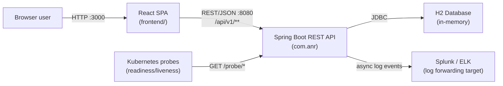
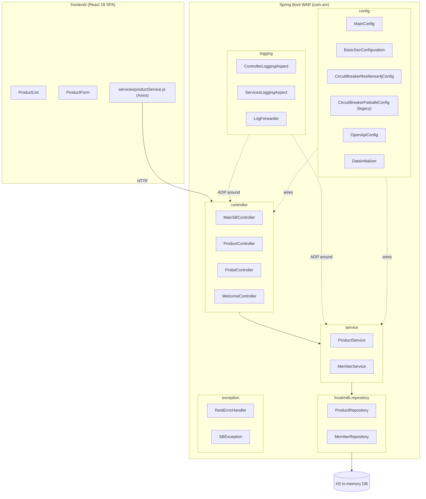
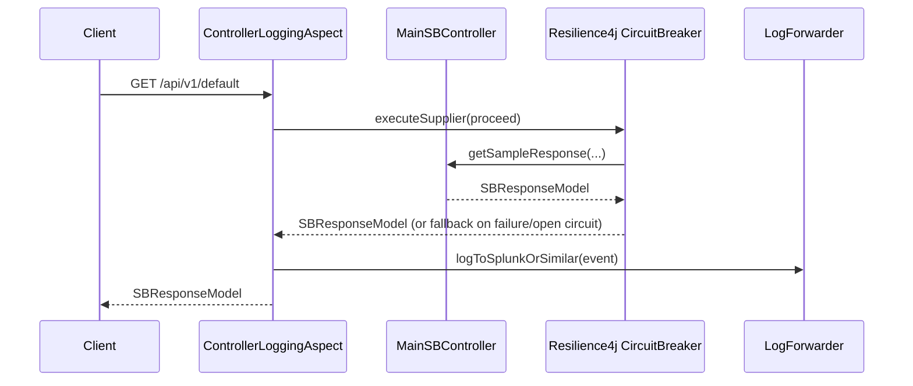

# Code Analysis — sprboot_api_cktBrkr (Pre-Upgrade Baseline)

**Purpose:** Capture the current design, architecture, dependency inventory, and version baseline of this application before a further upgrade of Java, Spring Boot, and all dependencies to their latest stable versions.
**Audience:** Amit Rajpurkar (Enterprise Architect); future readers/agents resuming this upgrade
**Status:** Draft
**Last updated:** 2026-11-05
**Related documents:** [`docs/Upgrade_Plan.md`](Upgrade_Plan.md), [`docs/PENDING_ACTIONS.md`](PENDING_ACTIONS.md), [`docs/UPGRADE_STATUS.md`](UPGRADE_STATUS.md), [`docs/FULLSTACK_ARCHITECTURE.md`](FULLSTACK_ARCHITECTURE.md), [`docs/RESILIENCE4J_MIGRATION.md`](RESILIENCE4J_MIGRATION.md), [`README.md`](../README.md)

---

## 0. How this document fits the project history

This repository has already been through one upgrade cycle (tracked in `docs/Upgrade_Plan.md`, `UPGRADE_STATUS.md`, `PENDING_ACTIONS.md`): Java 14 → 21, Spring Boot 2.3.3 → 3.2.10, Gradle 6.6 → 8.11.1/9.1.0 (see §6.3 for a discrepancy found in this claim), MongoDB → H2, Hystrix → Resilience4j. That cycle is recorded as "100% complete" as of October 2025.

This document is a **fresh, ground-truth re-analysis of the code as it exists today** (2026-11-05) — not a continuation of the prior migration log — because the next upgrade (to the latest Java, Spring Boot, and dependency versions) starts from what is actually in the repository, not from what earlier documents claimed was done. Where this analysis disagrees with an earlier doc, that is called out explicitly in §6.3 and §8.

---

## 1. System boundaries (in scope / out of scope)

**In scope for this analysis and the planned upgrade:**
- The Spring Boot backend under `src/main/java/com/anr/**` and `src/main/resources/**`
- The Gradle build (`build.gradle`, `settings.gradle`, `gradle/wrapper/*`)
- Backend test suites (`src/test/java/**`) and performance tests (`src/gatling/**`)
- The React frontend under `frontend/**` (secondary priority — see §5.5)
- Containerization (`Dockerfile`, `docker-compose.yml`)

**Out of scope for this analysis:**
- The large body of historical markdown documents in `docs/` (45+ files) describing prior migrations — treated as reference only, not re-verified line by line
- CI/CD pipeline design (no `.github/workflows` exists today — noted as a gap, not designed here)
- Production security hardening (authentication/authorization redesign) — noted as a known gap, not solved here

**Assumptions:**
- "Latest version" means the latest *generally available, stable* release of each component as of 2026-11-05, not a pre-release/milestone, unless explicitly noted
- The upgrade plan in §9 is a plan to be executed in a later, separate working session — this document does not change any code
- Local toolchain available during this analysis: JDK 21.0.12.1 (Homebrew), Gradle wrapper 8.11.1 — no JDK 25+ is installed locally yet (relevant to §9)

---

## 2. Architecture overview

### 2.1 C4 Context diagram

*Figure 1 — C4 Context level. A single-service Spring Boot API backing a React SPA, with an embedded H2 database and an outbound log-forwarding integration. No external upstream services are called at runtime today (the circuit breaker beans exist but currently wrap only an internal, in-process code path — see §5.1).*

### 2.2 C4 Container / module view

*Figure 2 — Container/module level. Layering is enforced at test time by `ArchitectureTest` (ArchUnit): Controller → Service → Repository, with Config and Logging cross-cutting both. This is a classic layered monolith, not a microservice decomposition.*

### 2.3 Package inventory (ground truth from `src/main/java/com/anr`)

| Package | Responsibility | Key classes |
|---|---|---|
| `com.anr` (root) | Application bootstrap | `Bootstrap` — `@SpringBootApplication`, extends `SpringBootServletInitializer` (WAR deployment), excludes `MongoAutoConfiguration` |
| `com.anr.controller` | REST endpoints | `MainSBController`, `ProductController`, `ProbeController`, `WelcomeController`, `ControllerFailureResponses` |
| `com.anr.service` | Business logic | `ProductService` (constructor injection, `@Transactional`), `MemberService` (field injection) |
| `com.anr.localmdb.model` | JPA entities | `Product`, `InsuranceMember`, `Policy`, `Plan` |
| `com.anr.localmdb.repository` | Spring Data JPA repositories | `ProductRepository`, `MemberRepository` |
| `com.anr.config` | Spring configuration | `MainConfig`, `BasicSecConfiguration`, `ConfigProperties`, `CircuitBreakerResilience4jConfig`, `CircuitBreakerFailsafeConfig`, `OpenApiConfig`, `DataInitializer`, `TraceInterceptor` |
| `com.anr.exception` | Error model | `SBException`, `SBNestedException`, `ErrorRootElement`, `RestErrorHandler` |
| `com.anr.logging` | Cross-cutting observability | `ControllerLoggingAspect`, `ServicesLoggingAspect`, `LogForwarder` |
| `com.anr.common` | Shared utilities | `SBUtil` (logging helper, exception-message extraction) |
| `com.anr.model` | API-facing DTO | `SBResponseModel` |

33 main Java files, 20 test Java files (JUnit 5 + Mockito + ArchUnit + REST Assured).

### 2.4 Notable design patterns observed

- **Builder pattern** — `Product.ProductBuilder`, used to construct the `Product.EMPTY` sentinel object (a null-object pattern substitute for `Optional`/404 handling in `ProductController`/`ProductService`).
- **Aspect-Oriented Programming** — `ControllerLoggingAspect` wraps `MainSBController.getSampleResponse(..)` with structured (Splunk-style) logging *and* routes the call through the Resilience4j circuit breaker (`defaultApiCircuitBreaker.executeSupplier(...)`); `TraceInterceptor` (extends Spring's `CustomizableTraceInterceptor`) is wired via a manual `Advisor`/pointcut in `MainConfig` against `com.anr.service..*`.
- **Configuration properties binding** — `@ConfigurationProperties("sbsvc")` (`ConfigProperties`) binds `application.properties` into typed nested classes (`WaitProperty`, `Executor`); mixes legacy Hystrix-named fields (`hyxCbSleepWindowMS`, `hyxThrdPoolCoreSize`, …) with current Resilience4j usage — i.e., config vocabulary still reflects the retired Hystrix integration (see §6).
- **Optimistic locking** — `Product.version` (`@Version`) for concurrent-update safety.
- **CommandLineRunner data seeding** — `DataInitializer` loads demo `Product` and `InsuranceMember` data into H2 on every startup (`ddl-auto=create-drop`), i.e. the embedded DB is transient and reset on each run — appropriate for a demo/sample app, not for a persistent service.
- **Layered-architecture enforcement as code** — `ArchitectureTest` (ArchUnit) actively enforces the controller→service→repository dependency direction and naming/annotation conventions on every test run; this is a strong, currently-functioning guardrail that the upgrade plan should keep green at every phase.

---

## 3. Request flow — representative example

*Figure 3 — The only endpoint currently wrapped end-to-end by the circuit breaker + structured logging combination is `MainSBController.getSampleResponse`. `ProductController`'s CRUD endpoints (the actual functional surface of the app) are **not** wrapped by `ControllerLoggingAspect` or any circuit breaker — the resilience pattern is demonstrated, not applied, to the product API.*

---

## 4. Current technology stack & dependency inventory

### 4.1 Backend — declared in `build.gradle`

| Category | Dependency | Declared version | Notes |
|---|---|---|---|
| Language/runtime | Java | **21** (`sourceCompatibility`/`targetCompatibility`) | Test task pins JVM toolchain to 21 explicitly; README separately claims "25 (compilation)" — not reflected in `build.gradle` (see §6.3) |
| Build tool | Gradle | wrapper pins **8.11.1** | README claims 9.1.0 — mismatch, see §6.3 |
| Framework | `org.springframework.boot` plugin | **3.2.10** | Released Sept 2024; Spring Boot 3.2.x goes EOL (OSS support) well before this upgrade executes |
| Framework | `io.spring.dependency-management` | 1.1.6 | Version-managed BOM plugin |
| Web | `spring-boot-starter-web` | managed by BOM (3.2.10) | Embedded Tomcat |
| Security | `spring-boot-starter-security` | managed by BOM | Lambda-DSL `SecurityFilterChain`, **`permitAll()` on all requests, CSRF disabled** (see §6) |
| Validation | `spring-boot-starter-validation` | managed by BOM | Jakarta Bean Validation on `Product` |
| Observability | `spring-boot-starter-actuator` | managed by BOM | `health`, `info`, `metrics`, `beans` enabled |
| AOP | `spring-boot-starter-aop` | managed by BOM | Backs `ControllerLoggingAspect`/`ServicesLoggingAspect` |
| Persistence | `spring-boot-starter-data-jpa` | managed by BOM | Hibernate ORM |
| Database | `com.h2database:h2` | **2.2.224** | In-memory only (`jdbc:h2:mem:sampledb`), `ddl-auto=create-drop` |
| API docs | `org.springdoc:springdoc-openapi-starter-webmvc-ui` | **2.3.0** | Swagger UI + OpenAPI 3 |
| Circuit breaker (current) | `io.github.resilience4j:resilience4j-spring-boot3` / `-circuitbreaker` / `-timelimiter` / `-bulkhead` | **2.2.0** | Primary resilience mechanism |
| Circuit breaker (legacy/parallel) | `net.jodah:failsafe` | **2.4.4** | `CircuitBreakerFailsafeConfig` still defines a second, independent circuit-breaker bean (`CBFSDefaultApi`) — unused by any controller/service, a leftover from the Hystrix→Resilience4j migration (see §6) |
| Utility | `com.google.guava:guava` | **33.0.0-jre** | |
| Utility | `com.google.code.gson:gson` | **2.10.1** | Used for manual JSON building in logging/AOP code alongside Spring's Jackson |
| Utility | `commons-io:commons-io` | **2.15.1** | |
| Utility | `org.apache.commons:commons-lang3` | **3.14.0** | |
| Code generation | `org.projectlombok:lombok` | **`edge-SNAPSHOT`** | **Not a pinned release** — resolved from `https://projectlombok.org/edge-releases`, a non-reproducible, non-Maven-Central, nightly-build coordinate (see §6 — highest-priority hygiene fix) |
| Test | `spring-boot-starter-test`, `junit-platform-launcher` | managed by BOM | JUnit 5 |
| Test | `org.hamcrest:hamcrest-all` | **1.3** | Superseded by `org.hamcrest:hamcrest` (2.x), bundled transitively via `spring-boot-starter-test` |
| Test | `org.mockito:mockito-core` / `mockito-junit-jupiter` | **5.8.0** | |
| Test | `com.tngtech.archunit:archunit-junit5` | **1.2.1** | Backs `ArchitectureTest` |
| Test | `io.rest-assured:rest-assured` / `json-path` / `json-schema-validator` | **5.4.0** | |
| Perf test | `io.gatling.gradle` plugin + `gatling-charts-highcharts` / `gatling-app` / `gatling-recorder` | plugin **3.10.5.1**, libs **3.10.5** | Scala-based load/stress/endurance/circuit-breaker simulations in `src/gatling/scala` |
| Coverage | `jacoco` (plugin) | toolVersion **0.8.12** | |

### 4.2 Removed/disabled but still present in source (dead or vestigial code)

| File | State | Observation |
|---|---|---|
| `config/CircuitBreakerHystrixConfig.java.deprecated` | `.deprecated` extension — excluded from compilation | Hystrix removed from the dependency graph; file kept for historical reference only |
| `config/LocalmdbMongoConfig.java.deprecated` | `.deprecated` | MongoDB config, superseded by H2 |
| `config/MultipleMongoConfig.java.deprecated` | `.deprecated` | Same |
| `service/CollectionUpload.java.deprecated` | `.deprecated` | Same |
| `config/CircuitBreakerFailsafeConfig.java` | **active, compiled** | Not `.deprecated`, but functionally dead — no caller wires `CBFSDefaultApi` into any controller/service |
| `Bootstrap.java` comments | n/a | Commented-out `@EnableCircuitBreaker`/Hystrix import left in place as historical breadcrumbs |

### 4.3 Frontend — declared in `frontend/package.json`

| Dependency | Declared version | Notes |
|---|---|---|
| `react` / `react-dom` | **^18.2.0** | |
| `axios` | **^1.6.0** | HTTP client, `proxy` to `localhost:8080` in dev |
| `react-scripts` (Create React App) | **5.0.1** | **CRA was officially sunset by the React team (Feb 2025)** — no longer actively maintained; this is the single highest-leverage frontend modernization item (see §9, Phase 6) |
| `@testing-library/react` | ^13.4.0 | |
| `@testing-library/jest-dom` | ^5.16.5 | |
| `@testing-library/user-event` | ^14.4.3 | |
| `axios-mock-adapter` | ^1.21.5 | |

### 4.4 Containerization

- `Dockerfile`: multi-stage, `eclipse-temurin:21-jdk-alpine` (build) → `eclipse-temurin:21-jre-alpine` (runtime), builds and runs the **WAR** artifact (`bootWar`), non-root `spring` user, G1GC + container-aware JVM flags, actuator-based `HEALTHCHECK`.
- `docker-compose.yml`: single `app` service on H2 (no external DB container) — comment history in `PENDING_ACTIONS.md` referencing a MongoDB container is stale; current compose file is already H2-only and consistent with the code.
- No `.github/workflows` — there is no CI pipeline. Every "test/build green" claim in the historical docs was produced by a local run, not an automated, reproducible gate.

---

## 5. Design-level observations relevant to the upgrade

### 5.1 Circuit breaker: two implementations, one unused, neither protecting the real API
Resilience4j (`CircuitBreakerResilience4jConfig`) is the documented, "current" mechanism, and it is correctly wired into `ControllerLoggingAspect` around `MainSBController.getSampleResponse`. However:
- `CircuitBreakerFailsafeConfig` (Jodah Failsafe) still exists, compiles, and registers a Spring bean — it is pure legacy weight with no caller.
- `ProductController` — the only endpoint set with real business logic (CRUD against H2) — has **no** circuit breaker, timeout, or bulkhead applied at all.

### 5.2 Security posture
`BasicSecConfiguration` disables CSRF and permits all requests unconditionally (`authorizeHttpRequests(auth -> auth.anyRequest().permitAll())`). `application.properties` also sets a default Spring Security basic-auth user/password (`user`/`password`) that is never enforced because of the `permitAll()` rule, and the same literal credentials are duplicated into `docker-compose.yml` environment variables. This is acceptable for a local demo but is explicitly flagged by the project's own `PENDING_ACTIONS.md` as unresolved for production use. Out of scope to fix here (per §1), but it will interact with the Spring Security major-version bump in §9 (Spring Security's lambda DSL has continued to evolve across Spring Boot 3.3→3.5→4.x) and should be re-verified, not just recompiled, during the upgrade.

### 5.3 Configuration naming debt
`ConfigProperties.WaitProperty` still exposes Hystrix-era field names (`hyxCbSleepWindowMS`, `hyxThrdPoolCoreSize`, `hyxThrdPoolMaxQueSize`, …) that are now consumed by Resilience4j config classes under different semantics. This is working correctly today but is a readability/maintenance hazard for anyone (human or agent) touching circuit-breaker tuning next.

### 5.4 Dual JSON libraries
Jackson (via Spring Boot's default converters) and Gson (`MainConfig.gson()` bean, used in `ControllerLoggingAspect` for log-message serialization) are both present. Not a defect, but worth consolidating opportunistically during the dependency bump since Gson adds a second JSON engine to patch/track for no functional gain over Jackson for this use case.

### 5.5 Frontend is a secondary, lower-risk upgrade track
The React app is a small, self-contained CRUD UI (3 components, Axios service layer, Jest tests) against `ProductController`. It has no shared build with the backend (separate `package.json`, separate test runner) and no coupling beyond the REST contract, so it can be upgraded independently and in parallel with the backend track without blocking it.

### 5.6 ArchUnit as an upgrade safety net
`ArchitectureTest` already enforces layering, naming, and annotation conventions, and even asserts **no classes depend on anything annotated `@Deprecated`**. This test suite is a ready-made regression gate for the upgrade: if a Phase in §9 breaks layering or reintroduces a deprecated API, this test will fail before manual review is needed.

---

## 6. Findings — current state vs. documented state

| # | Finding | Evidence | Severity |
|---|---|---|---|
| 6.1 | Lombok is pinned to a non-reproducible nightly build (`edge-SNAPSHOT` from a non-Central repository) instead of a stable release | `build.gradle:105-106`, custom repo `build.gradle:35-37` | High — breaks reproducible builds; must be fixed independently of the version-upgrade work |
| 6.2 | `CircuitBreakerFailsafeConfig`/Jodah Failsafe is dead code (no caller) left over from the Hystrix migration | `config/CircuitBreakerFailsafeConfig.java`, no references found outside the class itself | Medium — adds a dependency and maintenance surface with zero runtime value |
| 6.3 | **Gradle version discrepancy**: `README.md` states "Gradle 9.1.0"; the actual `gradle/wrapper/gradle-wrapper.properties` pins **8.11.1**, confirmed by `./gradlew --version` output (`Gradle 8.11.1`) | `gradle/wrapper/gradle-wrapper.properties`, live `./gradlew --version` run | Medium — documentation does not match the shipped build; must reconcile before claiming the Gradle leg of the *next* upgrade is "already done" |
| 6.4 | `README.md` states Java "25 (compilation)"; `build.gradle` only declares Java 21, and no JDK 25 toolchain is configured or installed locally | `build.gradle:28-31`, `java -version` → 21.0.12.1, `/usr/libexec/java_home -V` → only JDK 21 present | Medium — claim is aspirational/stale, not yet true of the checked-in build |
| 6.5 | The circuit breaker and structured-logging aspect protect a demo endpoint (`/api/v1/default`) and do not cover the actual product CRUD API | `ControllerLoggingAspect` pointcut, `ProductController` | Low-Medium — functional gap, not an upgrade blocker, but worth a backlog item once the version upgrade lands |
| 6.6 | `ConfigProperties` field names still use Hystrix-era vocabulary for Resilience4j settings | `config/ConfigProperties.java` | Low — readability debt only |
| 6.7 | No CI pipeline (`.github/workflows` absent) | `find .github` → empty | Medium — every "all tests passing" claim in prior docs is a local, unverified assertion; an upgrade of this scope should not proceed without an automated build/test gate |
| 6.8 | Create React App (`react-scripts`) is end-of-life upstream | `frontend/package.json`, React team's official Feb 2025 CRA sunset announcement | Medium (frontend track) — not urgent to function, but it is the correct moment to migrate build tooling since the backend is being touched anyway |

---

## 7. Version research — current vs. latest available (as of 2026-11-05)

> Researched via web search on 2026-11-05; always re-verify exact patch numbers against Maven Central / the tool's own release page immediately before executing each phase, since these move continuously.

| Component | Current (this repo) | Latest stable available | Jump size |
|---|---|---|---|
| Java | 21 (LTS) | **25** (LTS, GA Sept 2025); 27 is the newest non-LTS feature release (Sept 2026) | 1 LTS generation (21→25); skip 27 unless a non-LTS release is explicitly wanted |
| Spring Boot | 3.2.10 | **4.1.2** (Oct 2026) | **Major version** — crosses the 3.x→4.0 boundary; Spring's own migration guide recommends landing on the latest 3.5.x *first* |
| Spring Framework (transitive) | 6.1.x (via Boot 3.2.10) | 7.x (ships with Boot 4.x) | Major — Jakarta EE 11 / Servlet 6.1 baseline |
| Gradle | 8.11.1 (actual) / 9.1.0 (claimed, unverified) | **9.8.2** (Oct 2026) | Needs reconciliation first (§6.3), then one more minor bump |
| Resilience4j | 2.2.0 | **2.4.0** (Mar 2026) | Minor |
| springdoc-openapi | 2.3.0 (`-starter-webmvc-ui`) | **2.9.x** (2.x line) or **3.2.0** (new major, SB4-aligned) | Minor within 2.x, or major if paired with Spring Boot 4 |
| Lombok | `edge-SNAPSHOT` (unpinned) | **1.18.48** (Sept 2026) | Fix pinning first — this is not really a "version jump," it's a correctness fix |
| Mockito | 5.8.0 | **5.24.0** (Sept 2026) | Minor |
| React (frontend) | 18.2.0 | **19.2.7** (June 2026) | Major, independent track |
| react-scripts / CRA | 5.0.1 | N/A — recommend migrating to **Vite** rather than chasing a CRA release | Tooling replacement, not a version bump |

Sources: [Spring Boot versions/EOL](https://www.herodevs.com/blog-posts/spring-boot-versions-eol-dates-and-latest-releases-april-2026), [Spring Boot 4.0 Migration Guide](https://github.com/spring-projects/spring-boot/wiki/Spring-Boot-4.0-Migration-Guide), [Java version history](https://en.wikipedia.org/wiki/Java_version_history), [Gradle release notes](https://docs.gradle.org/current/release-notes.html), [Resilience4j releases](https://github.com/resilience4j/resilience4j/releases), [springdoc-openapi on Maven Central](https://mvnrepository.com/artifact/org.springdoc/springdoc-openapi), [Mockito on Maven Central](https://mvnrepository.com/artifact/org.mockito/mockito-core), [Lombok on Maven Central](https://mvnrepository.com/artifact/org.projectlombok/lombok), [Sunsetting Create React App](https://react.dev/blog/2025/02/14/sunsetting-create-react-app), [bswen: Spring Boot 4 minimum Java version](https://docs.bswen.com/blog/2026-03-04-spring-boot-4-java-version/).

**Key fact that de-risks the plan:** Spring Boot 4.0 only *requires* Java 17+; it does not force a simultaneous Java 25 jump. This means the Java-version upgrade and the Spring-Boot-version upgrade are **independent, separable decisions** — each can be validated on its own before combining them (see §9 ordering).

---

## 8. Open questions

- [ ] **Gradle actual-vs-claimed version (6.3)** — confirm with Amit whether 8.11.1 is intentional (and README should be corrected) or whether a 9.x bump was intended but never landed — owner: Amit, before Phase 1 of §9
- [ ] **Does Spring Boot 4.x retain `SpringBootServletInitializer`/WAR packaging?** Search results were inconclusive (deprecated, not confirmed removed) — must be verified against the official Spring Boot 4.0 migration guide before Phase 4 of §9, since this app currently ships a WAR via `war` plugin + Docker
- [ ] **Keep or remove the dead `CircuitBreakerFailsafeConfig`/Failsafe dependency?** — recommend removal as part of the upgrade (reduces surface area) — confirm with Amit
- [ ] **Is a CI pipeline in scope for this upgrade effort, or a separate follow-on task?** — recommend adding a minimal GitHub Actions build+test gate before Phase 2 of §9, so every subsequent phase has an automated pass/fail signal instead of local-only verification

---

## 9. Upgrade plan — staged, step-by-step

Ordering principle (per the problem-solving protocol): **highest-risk, most-reversible-if-wrong units first**, each phase independently buildable and testable, with `ArchitectureTest` and the existing JUnit suite as the regression gate at every step. No phase starts until the previous phase's tests are green.

### Phase 0 — Groundwork (no version changes)
1. Reconcile the Gradle discrepancy (§6.3): decide the true current version, correct `README.md` or the wrapper, whichever is wrong.
2. Pin Lombok to `1.18.48` (stable), removing the `projectlombok.org/edge-releases` repository from `build.gradle`. This is a correctness fix, independent of the rest of the upgrade, and should land first since it affects build reproducibility for every later phase.
3. Remove dead code: `CircuitBreakerFailsafeConfig` + `net.jodah:failsafe` dependency (pending Amit's confirmation in §8).
4. (Recommended, confirm with Amit) Add a minimal CI workflow (`./gradlew clean build test jacocoTestReport`) so every later phase has an automated gate, not just a local one.
5. **Exit criteria:** `./gradlew clean build test` green with the pinned Lombok version and no Failsafe references; `ArchitectureTest` passes.

### Phase 1 — Gradle → 9.8.2
1. Bump `gradle/wrapper/gradle-wrapper.properties` to the Gradle 9.8.2 distribution.
2. Run `./gradlew wrapper --gradle-version 9.8.2` and resolve any deprecation warnings Gradle itself surfaces (Gradle 9.x removed several Gradle-8-deprecated APIs).
3. **Exit criteria:** clean build + full test suite green on Gradle 9.8.2, still on Spring Boot 3.2.10 / Java 21 (i.e., isolate the build-tool variable before touching framework or language).

### Phase 2 — Java 21 → 25 (LTS), Spring Boot unchanged
1. Install JDK 25 locally (none present today — see §1 assumptions) and update `build.gradle`'s `sourceCompatibility`/`targetCompatibility` and the `test` task's `javaLauncher` toolchain to `JavaLanguageVersion.of(25)`.
2. Re-run the full test suite on Java 25 while still on Spring Boot 3.2.10, to isolate language-runtime regressions from framework regressions.
3. Pay particular attention to JaCoCo (`0.8.12`) — the project's own build comment notes "JaCoCo doesn't support Java 25" for a prior forced-21 test launcher; verify current JaCoCo 0.8.12 Java-25 support before relying on coverage reports, and bump JaCoCo if a Java-25-compatible release exists.
4. **Exit criteria:** build + tests + coverage green on Java 25, Spring Boot still 3.2.10.

### Phase 3 — Spring Boot 3.2.10 → latest 3.5.x (staging step before the major jump)
1. Per Spring's own migration guidance, land on the newest Spring Boot 3.x (3.5.x line) before attempting 4.x — this absorbs the accumulated 3.3/3.4/3.5 deprecations in smaller, reversible increments.
2. Update `springdoc-openapi-starter-webmvc-ui` to the latest 2.x compatible with that Boot version; re-verify Swagger UI renders and `GroupedOpenApi` API hasn't changed again.
3. Re-run ArchUnit + full suite after each minor bump (3.3 → 3.4 → 3.5), not only at the end — Spring Boot minor releases have historically changed actuator/security auto-configuration defaults.
4. **Exit criteria:** build + tests green on latest Spring Boot 3.5.x, Java 25, Gradle 9.8.2.

### Phase 4 — Spring Boot 3.5.x → 4.1.2 (the major-version jump — highest risk)
1. **Before writing code:** resolve the open question on WAR/`SpringBootServletInitializer` support in Boot 4 (§8). If WAR packaging is removed or discouraged, decide now whether to switch to an executable JAR + embedded Tomcat (the already-Dockerized deployment model supports this with minimal `Dockerfile`/`build.gradle` changes) — **this decision point is exactly the kind of "expensive to reverse" choice the SWE operating instructions require an ADR for; draft `docs/decisions/ADR-001-spring-boot-4-and-deployment-packaging.md` before proceeding.**
2. Use Spring's official Spring Boot 4.0 migration tooling/guide against the 3.5.x baseline from Phase 3.
3. Re-verify: Security `SecurityFilterChain` lambda DSL (API has continued to shift across 3.x releases and now Spring Framework 7), actuator endpoint exposure defaults, Jackson/Hibernate versions pulled transitively by the Boot 4 BOM, and `springdoc-openapi` (move to the SB4-aligned line — 3.2.0 — if the 2.x line does not support Boot 4).
4. Update Resilience4j to 2.4.0 and confirm `resilience4j-spring-boot3` has a Boot-4-compatible counterpart (naming may change with the major Boot version — verify at execution time).
5. **Exit criteria:** build + full test suite + ArchUnit green on Spring Boot 4.1.2.

### Phase 5 — Minor/patch dependency sweep
1. Bump the remaining pinned libraries to their current stable releases: Guava, Gson, commons-io, commons-lang3, H2, Mockito (5.24.0), Gatling, JaCoCo, ArchUnit, REST Assured, Hamcrest (replace `hamcrest-all:1.3` with the maintained `org.hamcrest:hamcrest` already pulled transitively, rather than keeping a second, stale artifact).
2. Re-verify every dependency's exact latest version against Maven Central at execution time (§7's table is a point-in-time snapshot from today's research, not a pin list).
3. **Exit criteria:** full suite green, no dependency left pinned below its current stable release line (barring a documented, deliberate exception).

### Phase 6 — Frontend track (parallel, independent of Phases 1-5)
1. Migrate `frontend/` off Create React App onto Vite (CRA is upstream-deprecated; this is a tooling replacement, not a version bump — see §4.3, §6.8).
2. Bump React/`react-dom` to 19.2.7; re-run the existing Jest/RTL suite and fix any React-19-specific breakages (notably stricter `act()`/concurrent-rendering warnings).
3. **Exit criteria:** `npm run build` + `npm test` green on Vite + React 19, serving the same `ProductController` contract — no backend coordination required since the only coupling is the REST contract.

### Phase 7 — Documentation and closeout
1. Update `README.md`'s technology-stack table to the new, verified versions (fixing the §6.3/§6.4 discrepancies as part of this, not before).
2. Record the Spring-Boot-4/WAR-packaging decision as a completed ADR (promote the Phase-4 draft from "Proposed" to "Accepted").
3. Produce a short post-upgrade test/build results summary (mirroring the existing `FINAL_TEST_RESULTS.md` pattern) so the next reader has the same kind of evidence this document relied on.

---

## 10. Summary

The application is a small, well-tested (ArchUnit-enforced) layered Spring Boot monolith on Java 21 / Spring Boot 3.2.10 / Gradle 8.11.1, paired with an independent React 18 SPA, already one upgrade cycle removed from its original Java 14 / Spring Boot 2.3 / MongoDB / Hystrix baseline. The codebase carries visible scar tissue from that prior migration (an unpinned Lombok build, a dead Failsafe circuit breaker, Hystrix-named config fields, a stale Gradle-version claim) that should be cleaned up as Phase 0 rather than carried into the next upgrade. The next upgrade itself is dominated by one genuinely major decision — Spring Boot 3.x → 4.x, which also pulls in Spring Framework 7 and raises the WAR-packaging question — surrounded by otherwise-routine minor/patch bumps (Java 21→25, Gradle 8→9.8, Resilience4j, springdoc-openapi, and the usual utility libraries). The phased plan in §9 isolates that one major decision into its own phase, bracketed by smaller, independently-verifiable steps on either side, with the project's existing ArchUnit and JUnit suites serving as the regression gate throughout.
